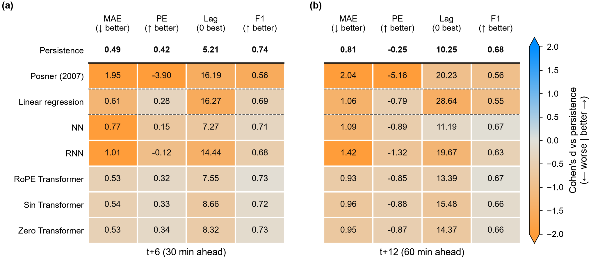
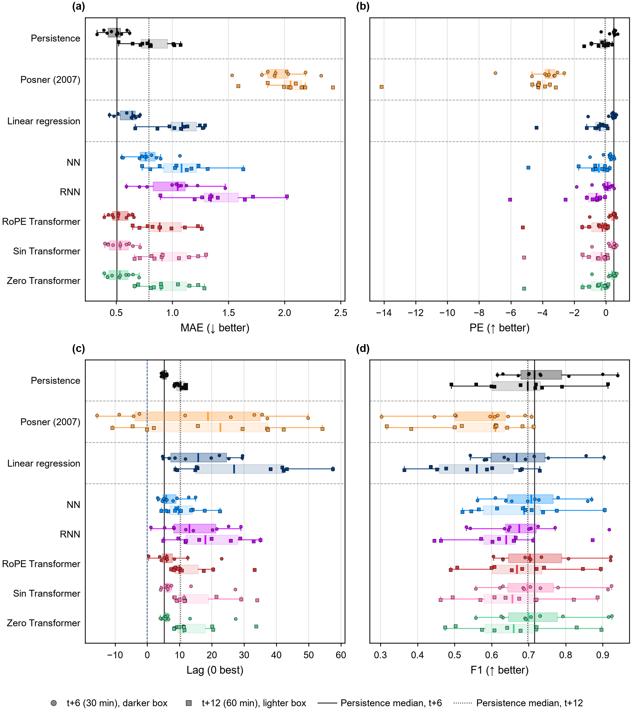
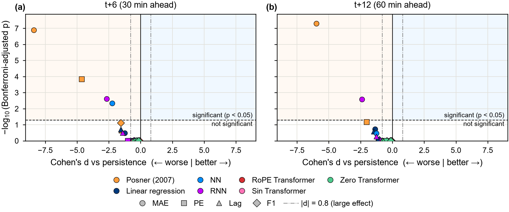
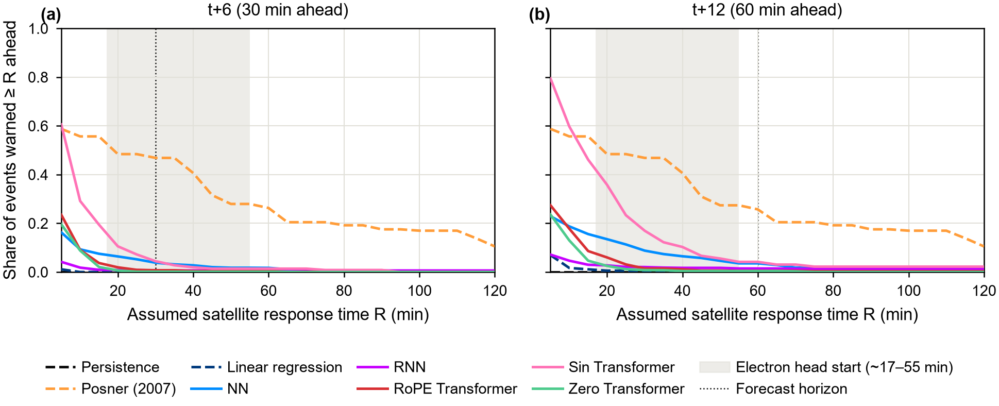

**Overarching question:** Can ML forecasts of >10 MeV protons give satellite operators enough warning to safe-mode before single-event upsets occur?
---
[[LaNeve 2024]]
* *Satellite operators are faced with a plethora of information, limited time for decision making, and limited knowledge of historical space weather relative to their other areas of expertise, causing the need for confident forecasts* (p6–7)
* Only 10% of satellite operators placed satellites into safe mode after a forecast; 58% increased staff situational awareness (p19).
* One operator's only "kinetic responses" in their history were *repositioning the satellite to avoid reaching proton thresholds* (p19).
* One operator avoided safe mode *citing that the loss of services would outweigh the risk of damage, and that the customers almost always opted for continued service* (p19).
* *the tyranny of distance between operators and equipment* (p24)
* Operators *identified the need for more accurate, localized, space weather warnings* (p2)

# Why SEP Forecasting?

[[Schrijver 2015]]
* *solar energetic-particle (SEP) storms, for example, impact satellites directly, while expansion of the terrestrial upper atmosphere by magnetospheric variability (through Joule heating) may affect low-orbiting satellites by modifying their orbits through increased drag which is an issue for on-orbit operations, collision avoidance, and could eventually lead to early re-entry*
* *A series of such storms during the 2003 October-November time frame, for example, saw considerable impacts on satellites through electronic single event upsets (SEUs), solar-array degradation, modified orbit dynamics for spacecraft in low-Earth orbits, and noise on both housekeeping data and instrument data*
* *the possibility to disrupt HF communications that are used by civil aviation in remote regions, especially over the oceans and poles.*
* *SEPs is very significant as their impact is greatest in the polar regions (where satcom backup is not currently available) and is long-lived (up to days) so that procedural measures are insufficient. Thus polar flights are diverted to other less vulnerable routes during SEP events, imposing significant extra costs on airlines (around $100k per diversion; National Research Council, 2008).*
* *SEP where these have strong fluxes at energies >500MeV) that penetrate to the Earth's atmosphere and interact with atmospheric neutral particles. Such collisions produce cascades of neutrons and ions that can interact with aircraft to produce single event effects (SEE) and increased dose rate for passengers and crew*
* *On a par with establishing the structure of the erupting solar field as it begins to propagate into the heliosphere is establishing how incoming solar-wind field structures interact with the magnetospheric field to drive geomagnetic variability either immediately or with delay after storing energy in the magnetotail. L1 in-situ particle and field measurements are critical in providing input to models for near-term forecasts, and for validation of longer-term forecasts of storms advancing through the heliosphere. Therefore, the continuity of L1 measurements should be ensured so that besides the needs of operational services also the needs from the research community are taken into account.*
* *energies below about 1GeV penetrate only poleward of about 55 degrees magnetic latitude* (§4.4, p19). This is why >10 MeV protons threaten polar and high-inclination LEO satellites, while equatorial LEO is largely shielded.
* *The prompt SEPs represent the most difficult forecasting problem* (Appendix D, Goal SH-4, p42)
* Goal SH-4b, Predict Rapidly Arriving SEPs (time scale minutes to hours): *relativistic and mildly relativistic particles (neutron monitors and GOES) to establish connectivity and forewarning of future, less energetic particles* (p43). This is the electron-precursor approach used here.

[[Tobiska 2015]]
* *The NOAA Space Weather Prediction Center issues a Watch (long-lead-time geomagnetic activity prediction), a Warning (some condition is expected), or an Alert (event threshold is crossed). A Watch is provided only for geomagnetic storms and not SEP events.*

[[Kasapis 2026]]
* *Space weather disturbances, particularly their more hazardous aspects, are driven by highly energetic solar events such as flares, coronal mass ejections (CMEs), and solar energetic particle (SEP) events*
* *SEPs are central to space weather concerns as they represent a major radiation hazard for astronauts, particularly during extravehicular activities, and for passengers and crew on high-latitude flights, Damage satellites, disrupt comms and impair navigation. Moon or mars mission no shielding from atmosphere*
* *SEP events pose significant challenges to space weather forecasting due to their rapid onset and variability and potential impact on both technological systems and human health*

[[Lohmeyer 2013]]
* *Particles greater than 10 MeV are capable of penetrating surface of a satellite. main sources are solar energetic protons (SPE) and galactic cosmic rays (GCRs)*
* *High energy protons were capable of causing SEUs*

[[Wilkinson 1991]]
* *Three main sources of particle radiation in space environment*
	1. *Galactic Cosmic Rays (GCRs)*
	2. ==*Energetic Solar Particles from solar flares*==
	3. *Energetic particles from radiation belts from Earths magnetosphere*
* *Primary cause of TDRS-1 SEUs during solar flares (2)*

[[Eastwood 2017]]
* *September 1859The "Carrington" event is the benchmark for extreme space weather studies. The solar flare, the geomagnetic storm, and the ==energetic particle flux== associated with this event make it one of the largest on record. Note that many crucial parameters were not measured directly, so its precise properties are subject to uncertainty. In particular, estimating the strength of the geomagnetic storm associated with the Carrington event has attracted some debate; initial estimates should be disregarded in favor of more recent analysis*
* *An extreme solar flare and coronal mass ejection caused very significant radio blackouts, ==solar radiation storms==, and a major geomagnetic storm.*
* *disruption to communications, specifically to the military, and marked the start of a significant U.S. investment in space weather monitoring*
* *SEPs can cause displacement damage (reducing device performance) and single event effects (SEEs), which are a growing issue as devices are miniaturized.*
* *During the 2003 Halloween storms, 47 satellites reported anomalies (out of 450 in orbit, i.e., ∼10%), one scientific satellite was lost, and 10 satellites lost operational service for more than one day. Complete losses have thus been rare since satellites are designed to tolerate a total dose over some lifetime, with good safety margins: temporary outages and fleet aging are both more likely.*

[[Gopalswamy 2024]]
* *SEP are major radiation hazards in space both inside earths magnetosphere and outside the up space. risk for HF comms, satellite operations and biological systems.*
* *SEP events result in frequent spacecraft anomalies. The frequency of spacecraft anomalies depends on the intensity energy range of SEP events, spacecraft altitude and spacecraft inclination*

# Why Machine Learning?

[[Whitman 2022]]
* Physics based models are computationally intensive, and the ability to produce a prediction ''in real time'' may be limited by the resources available, so they may not be readily incorporated into a forecasting workflow.

[[Kasapis 2026]]
* physics based models simulate particle acceleration and transport processes but require substantial computational resources
* empirical and statistical models provide predictions but rely heavily on historical correlations
* ML emerged as a powerful alternative tool uncovering non linear patterns across heliospheric datasets

[[Yu 2026]]
* *Physics and empirical models are limited by:*
	1. *uncertain inputs*
	2. *incomplete observational coverage*
	3. *tradeoff between realism and forecast timeliness*
* *ML Combines diverse solar heliospheric observations under a unified predictive framework*
	* *Across the tested configurations, the strongest performance was obtained when magnetic-field information was combined with historical proton flux and radiative indicators of eruptive activity*

[[Camporeale 2019]]
"*We have sophisticated [[First Principles]] physics based models to understand Space Weather events but it comes with issues*
1. *separation of scales in space and time involved.*
2. *short time lag between storm and satellite response*
3. *computational cost "*

[[Schrijver 2025]]
* *Statistical ionosphere models tuned with data from ground-based networks or low Earth orbiting (LEO) satellites can in many cases provide relatively good results for nowcasts or short-term forecasts… However, with increasing lead times more comprehensive physics-based modeling with data assimilation is required.* (§4.3, p18). Data-driven models are strongest at short lead times.

# Why Attention Based Models

[[Vaswani 2023]]

*(RNN) precludes parallelization within training examples, which becomes critical at longer
sequence lengths, as memory constraints limit batching across examples*

[[Cai 2020]]

*Traffic forecasting is a challenging problem due to the complexity of jointly modeling spatio-temporal dependencies
at different scales. Recently, several hybrid deep learning
models have been developed to capture such dependencies. These approaches typically utilize convolutional neural
networks or graph neural networks (GNNs) to model spatial dependency and leverage recurrent neural networks
(RNNs) to learn temporal dependency. However, RNNs
are only able to capture sequential information in the time
series, while being incapable of modeling their periodicity
(e.g., weekly patterns). Moreover, RNNs are difficult to parallelize, making training and prediction less efficient. In this
work we propose a novel deep learning architecture called
Traffic Transformer to capture the continuity and periodicity
of time series and to model spatial dependency.*

[[Zhao 2026]]

* Classical statistical approaches and early deep-learning architectures (RNNs, LSTMs, CNNs) have achieved notable progress, yet they exhibit structural limitations: recurrent models struggle with long-range dependencies, convolutional models require deep stacking to enlarge receptive fields, and both scale suboptimally to high-dimensional and high-volume data.*

# Motivation

Near-relativistic electrons (SOHO/EPHIN >0.25 and >0.67 MeV) reach L1 within roughly 10–13 min, while >10 MeV protons take roughly 30–65 min (scatter-free, ~1.15 AU field-line path; ~30 min for the fastest protons in the integral, ~65 min at 10 MeV). These are **first-arrival (onset) times** from velocity dispersion, giving a ~20–55 min electron head start on the proton *onset*.

The forecast target is not the proton onset but the **10 pfu crossing** of the >10 MeV flux, which comes after onset, often by hours in gradual events. Varies from 10-720 minutes from onset to "crossing". Electron onset comes no later than this, so the electron-onset-to-crossing interval is at least this long. The warning window for the actual target an event-dependent distribution. 

- **To do:** measure electron onset (EPHIN >0.25 MeV, first rise above pre-event background) for all 39 events, and use the **electron-onset → 10 pfu crossing** distribution as the available warning window in RQ2 and RQ3.

---

# RQ1: Do attention based models provide accurate SEP forecast by minimizing error in flux magnitude and lag?

Do deep-learning models (RoPE, Sin, Zero Transformers, AutoGluon TFT, Chronos-2) forecast >10 MeV proton flux 30 min (t+6) and 60 min (t+12) ahead more accurately with smaller time lag, than statistical baselines,  (linear regression, persistence) and or machine learning models (RNN, NN)?

## RQ1.1 Accuracy and timing (one-sided Welch t-test, unequal variances)

Each null hypothesis says the champion ($c$) is no better than the baseline ($b$). "Better" is higher for skill scores, lower for errors, and closer to zero for lags.

**Higher is better**
1. $H_0 \text{ F1}: \mu_c \leq \mu_b$ (F1 of the 10 pfu exceedance classification)
2. $H_0 \text{ PE}: \mu_c \leq \mu_b$ (prediction efficiency)

*Adding Heidke Skill scores*

**Lower is better**

3. $H_0 \text{ MAE}: \mu_c \geq \mu_b$
4. $H_0 \text{ MSE}: \mu_c \geq \mu_b$

**Closer to zero is better** (timing offset between forecast and observed curve, in 5-min steps)

5. $H_0 \text{ O2P lag}: |\mu_c| \geq |\mu_b|$ (over onset → peak)
6. $H_0 \text{ O2T lag}: |\mu_c| \geq |\mu_b|$ (over onset → 10 pfu crossing)
7. $H_0 \text{ ln10 lag}: |\mu_c| \geq |\mu_b|$ (at the 10 pfu crossing)

## RQ1.2 Consistency (Levene)

- $H_0: \sigma_\text{champ}^2 \geq \sigma_\text{base}^2$ vs $H_A: \sigma_\text{champ}^2 < \sigma_\text{base}^2$
- The standard Levene F-test is two-sided, so it cannot test this directional null. Instead, take the absolute deviations $|\theta_i - \text{median}|$ in each group (the Brown–Forsythe form of Levene's test) and compare their means with a **one-sided pooled t-test**. A smaller mean absolute deviation means a smaller variance.

## RQ1 Figures

**Preliminary: all models are 1-epoch runs and are not accucrate to comparing with torres and persistence**
---
**Scorecard.** Mean score of each model on each metric over the 10 bootstrap datasets, at 30 and 60 minutes ahead. Cell colour shows the effect size against persistence (Cohen's *d*; blue = better, orange = worse).

**Spread across datasets.** Each dot is one bootstrap dataset's score, with box plots showing the median and quartiles for each model and horizon. The vertical lines mark persistence's median, so the plot shows how consistently each model beats or trails it.

**Significance.** Each point is one model on one metric: x is the effect size against persistence, and y is the Bonferroni-adjusted p-value of the one-sided Welch t-test from RQ1.1 on a −log₁₀ scale. *(The current figure still uses two-sided p-values and needs regenerating to match.)* Points in the upper right are significantly and substantially better than persistence. The numbers behind the plot are in `rq1_tests_nophases.csv`.

---

# RQ2: What forecast time is sufficient enough for satelite operators to react to SEPs?

What is the end-to-end response time from SEP detection at L1 to satellite safe mode, and do ML forecasts of >10 MeV protons provide warning that exceeds it for GEO and polar LEO satellites? from [[LaNeve 2024]], we have *what* operators did during the 2024 solar maximum but not *how long* each step takes.

## RQ2.1 The response pipeline

**Condition for usable warning:**

*Rough sketch of response time*
$$T_\text{warn} \geq R = T_\text{data acq} + T_\text{alert} + T_\text{decide} + T_\text{uplink} + T_\text{safe}$$

-  Depending on if the satellite is in LEO or GEO $R$ could massively differ. $R$ is a distrubution

## RQ2.2 Do champion models clear the threshold more often?

- **Warning time** = $t_{\text{threshold}}$ − $t_\text{issue time of warning}$.
- **Usable warning** = warning time ≥ $R$.
- **False alarms.** Warning time on its own rewards over-forecasting: a model that always predicts >10 pfu gets maximum warning on every event. Operators avoid safe mode because lost service costs more than the risk ([[LaNeve 2024]], p19), so warning only counts alongside how often it is wrong.
  - **False alarm** = an alert period (same rule as the warning time) that does not overlap any observed 10 pfu crossing. Report the **false alarms per year** of test data.
  - **Main result:** a curve of usable-warning share vs. false alarms per year, traced by sweeping the alert threshold (e.g. 1–100 pfu forecast) for each model
  - **Single-number comparison:** usable-warning share at a fixed false-alarm rate (e.g. ≤ 1 per year), so models are compared at the same cost to operators.
- Tests (at the fixed false-alarm rate):
  - $H_0: \mu_{\text{warn},c} \leq \mu_{\text{warn},b}$ (Welch)
  - $H_0: p_c \leq p_b$ for the share of events with usable warning (McNemar, paired on the same events)
- Persistence gives about zero warning by construction, so linear regression is the main reference baseline here.
- **Context:** compare against NOAA SWPC **proton Warnings**, which are issued *before* an expected crossing ([[Tobiska 2015]]). Use the SWPC archive to get the Warnings' lead times and false-alarm rate for the same 39 events

## RQ2 Figure

*Preliminary:  all other models are 1-epoch runs.*
---
[[LaNeve 2024]]
* *Satellite operators are faced with a plethora of information, limited time for decision making, and limited knowledge of historical space weather relative to their other areas of expertise, causing the need for confident forecasts* (p6–7)
* Only 10% of satellite operators placed satellites into safe mode after a forecast; 58% increased staff situational awareness (p19).
* One operator's only "kinetic responses" in their history were *repositioning the satellite to avoid reaching proton thresholds* (p19).
* One operator avoided safe mode *citing that the loss of services would outweigh the risk of damage, and that the customers almost always opted for continued service* (p19).
* *the tyranny of distance between operators and equipment* (p24)
* Operators *identified the need for more accurate, localized, space weather warnings* (p2)
**Usable warning against response time.** For each assumed satellite response time $R$, the share of SEP events where an alert (a forecast reaching 10 pfu) was issued at least $R$ minutes before the observed crossing. Lines are means over the bootstrap datasets. The grey band marks the electron head start on proton *onset* (~17–55 min); the window to the 10 pfu crossing is usually longer (see Motivation). *(This figure does not yet account for false alarms, see RQ2.2.)*

---

# RQ3:  Do transformers maintin forecasting skill at larger time leads compared to competitor models

How does skill decay from t+6 → t+12 → t+18 → t+24 (30 min to 2 h)? At what horizon does each model stop beating persistence?

if models exploit the electron precursor, skill at predicting the 10 pfu crossing should fall off once the horizon exceeds the **electron-onset → 10 pfu crossing interval** for that event 

**Output:** each model's *maximum useful lead time*, the largest horizon where it still beats persistence significantly.

---

# RQ4: Do Transformers increase forecasting skill more as we expand particle time window compared to competitor models

Does a longer input window (6, 12, 25, 48 and 96 steps, i.e. 30 min to 8 h) improve forecasts? Do attention-based models use long context better than NN, RNN and linear regression?

gains level off once the window covers the electron onset. If Transformers don't benefit from longer context

---

# RQ5: Do Transformer forecasting skill increase as we increase model size compared to competitro models?

How sensitive is forecast skill to model size and training hyperparameters?

| Hyperparameter | Current value |
|---|---|
| `dim_val` | 16 |
| `n_encoder_layers` | 1 |
| `n_heads` | 2 |
| `learning_rate` | 0.001 |

## Future work (out of scope)

### FW1: Do additional characteristics of a solar storm, and observations off the Sun–Earth line, improve forecasts?

Does adding (a) remote-sensing precursors (flare X-rays, CME speed and width, type II/III radio bursts), (b) in-situ L1 solar wind (plasma, magnetic field), and (c) energetic-particle observations from spacecraft **off the Sun–Earth line** (STEREO-A, Solar Orbiter, Parker Solar Probe) to the EPHIN electron inputs improve the accuracy (RQ1) and warning time (RQ2) of >10 MeV proton forecasts?

[[Gopalswamy 2024]] [[Type III Radio Bursts]] [[Corona Mass Ejections]] [[Schrijver 2025]]

SEP ML models so far use only near-Earth inputs (L1, GEO, SDO), e.g. SEPNET [[Yu 2026]] and MEMPSEP. None use particle data from spacecraft off the Sun–Earth line, which the COSPAR/ILWS roadmap calls for (Goal SH-4c) [[Schrijver 2025]].

**Why it matters:** remote-sensing signals (X-rays, radio bursts, CMEs) arrive before the protons and could extend warning time. Off-line spacecraft can be magnetically connected to a source region before Earth is, which could help with poorly connected eastern events.

### FW2: Can real-time ML forecasts from current L1 spacecraft give enough warning?

Can models trained on historical SOHO/EPHIN data, run in real time on operational L1 data (SOLAR-1, with ACE and DSCOVR as backups), give at least $R$ minutes of warning (RQ2) for satellites in LEO/GEO?

- **Why SOLAR-1:** SOLAR-1 (launched September 2025 as SWFO-L1) is NOAA's operational replacement for ACE and DSCOVR at L1. It addresses two needs from the COSPAR/ILWS roadmap [[Schrijver 2025]]:
  1. **Continuity of L1 measurements.** *"L1 in-situ particle and field measurements are critical in providing input to models for near-term forecasts… Therefore, the continuity of L1 measurements should be ensured"*. SOHO (1995) and ACE (1997) are ageing research missions; SOLAR-1 is a dedicated operational successor.
  2. **Near-real-time data.** The roadmap emphasises *"the importance of near-real-time data availability"* as a general recommendation for space weather data. SOLAR-1 is built for operational real-time delivery, which is what a live warning system needs (shrinking $T_\text{data}$ in RQ2).

- **Link to RQ2:** real-time operation shrinks $T_\text{data}$ and $T_\text{alert}$; an automated on-board or pre-authorised response would remove $T_\text{decide}$ and $T_\text{uplink}$ for polar LEO.

### FW3: Can proton flux forecasts be turned into SEU probabilities?

Can forecast >10 MeV proton flux be converted into the probability of a single-event upset on a satellite in the next 30–60 minutes, by orbit?

very few studies link SEP forecasts to actual SEUs, because satellite anomaly data is proprietary. *"Unfortunately, detailed information on satellite anomalies is generally not released by companies that design or operate satellites"* [[Schrijver 2025]] (§5.2, p25). Operators *"may hold certain information as controlled information, thus limiting the responses"* [[LaNeve 2024]] (p25). The Inmarsat record is one of the few public exceptions.

**Need for telemetry data:** linking SEPs to SEUs needs time-stamped satellite telemetry, not just anomaly reports:
  - SEU indicators: memory error-correction (EDAC) counts, bit-flip/scrub logs, processor resets, safe-mode entries.
  - Context: orbit position (to know when the satellite was outside geomagnetic shielding), shielding and device type.

    *"there is a big gap between the knowledge of the space environment and the statistics of satellite anomalies"*  and  [[Schrijver 2025]].

  Public telemetry lacks timing: NASA's open-source telemanom dataset (SMAP and MSL; 82 channels, 105 labelled anomalies, including radiation channels) states *"All data has been anonymized with regard to time and all telemetry values are pre-scaled between (-1,1)"*, so anomalies cannot be matched to SEP events (Hundman et al., 2018; [NASA NPO-50838-1](https://software.nasa.gov/software/NPO-50838-1)).
  
  Other telemetry is withheld: Yu et al. (2025, *Meas. Sci. Technol.* 36 015128) tested spacecraft anomaly detection on two telemetry datasets that *"cannot be made publicly available upon publication because they contain commercially sensitive information"* ([doi:10.1088/1361-6501/ad9495](https://iopscience.iop.org/article/10.1088/1361-6501/ad9495)).
  
  Methods are ready: ML telemetry anomaly detectors (telemanom's LSTM forecast-error method; Yu et al.'s MINE + LSTM-VAE with attention) could flag SEU-like anomalies once time-stamped telemetry is obtained. Neither study looks at radiation or space-weather causes.

**Evidence that SEPs drive SEUs:** [[Lohmeyer 2013]] used Inmarsat's archive of 226+ SEUs over about 20 years to test how often upsets fall within set time windows after >10 MeV solar proton events, and found high-energy protons capable of causing SEUs.

 SEU rate $\lambda(t) = \int \sigma(E)\,\phi(E,t)\,dE$ from the device cross-section $\sigma(E)$ and the forecast proton flux $\phi$, then a Poisson probability $P(\geq 1\ \text{SEU}) = 1 - e^{-\int \lambda\,dt}$ over the warning window.

operators could safe-mode on "P(SEU) above a set threshold" rather than "flux above 10 pfu", giving the specific, satellite-level warning operators asked for in [[LaNeve 2024]].

compare forecast SEU probabilities against the Lohmeyer Inmarsat SEU record.

SEU cross-sections depend mostly on higher energies than >10 MeV, so the proton spectrum is needed (e.g. EPHIN P25/P41 as extra targets). Cross-sections vary by device. Validation is limited to whatever SEU data can be obtained (Inmarsat, or operators willing to share under agreement).

### Other future work

- d_proton (proton derivative) as an extra input.
- A different solar cycle, for generalisation.
- Coupling with or comparing against CCMC physics models (EPREM, iPATH, HESPERIA REleASE).
